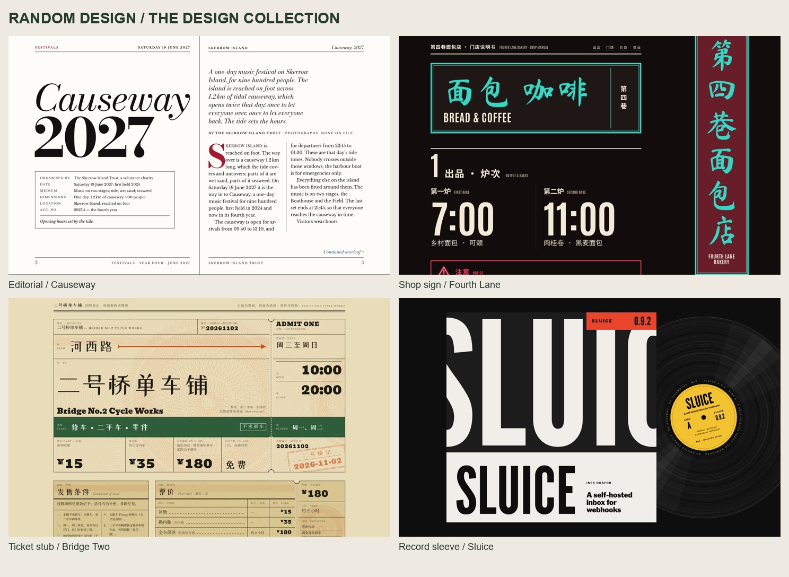
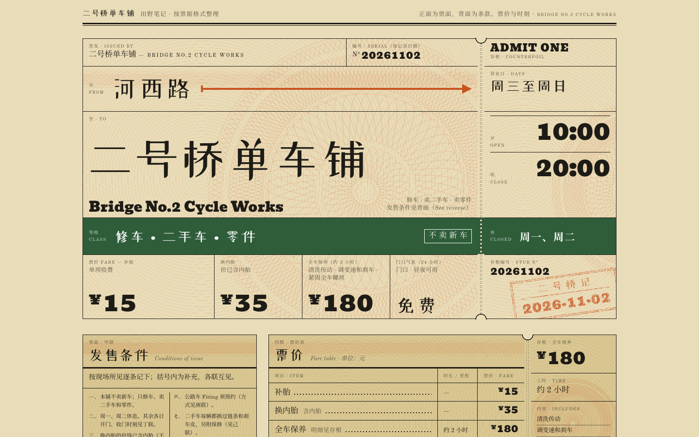
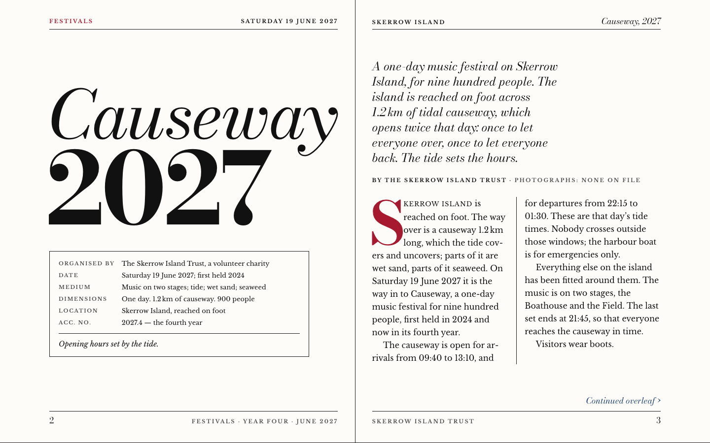
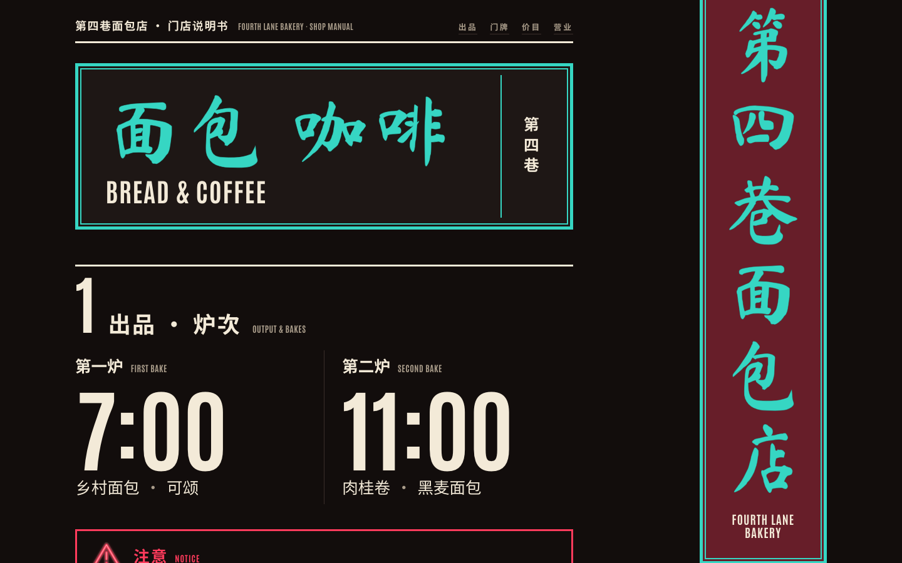
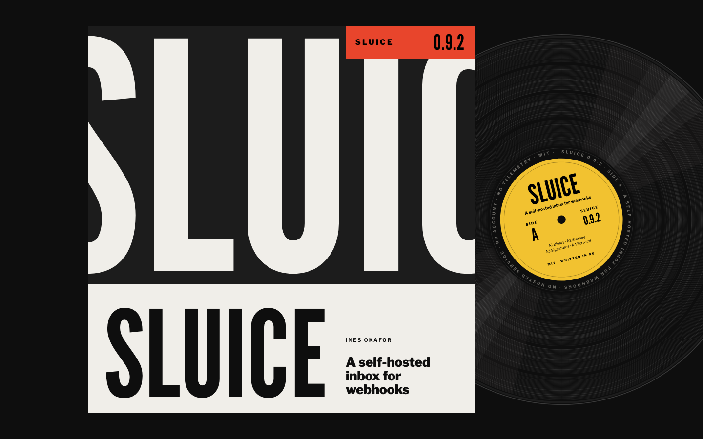
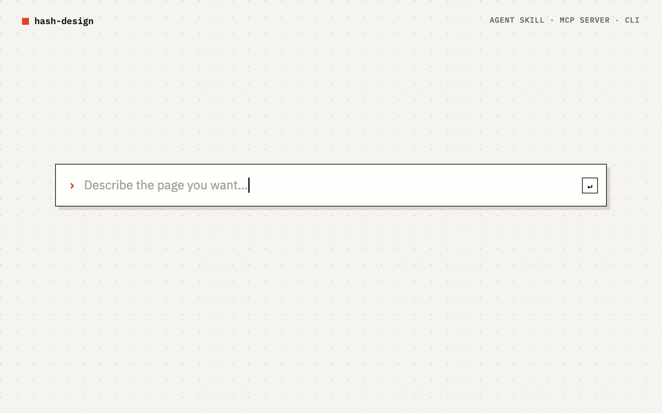
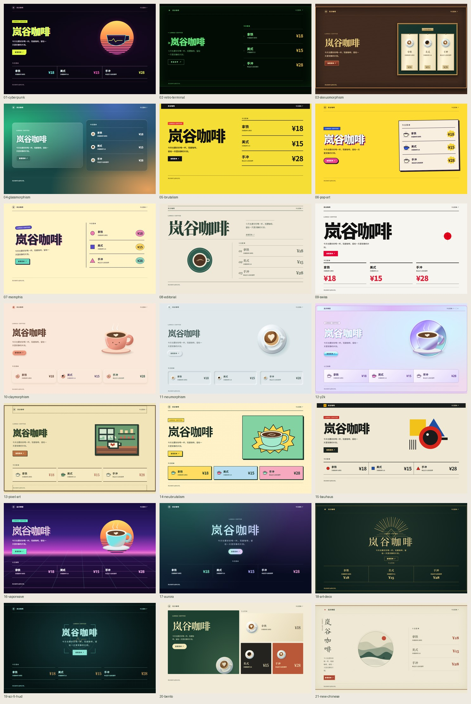

[**简体中文**](README.md) · [**English**](README.en.md)

# random-design

### See the design. Choose a direction. Make it yours.

Compare visual directions for websites and presentations. Keep reusable design specifications.

[**Open studio ↗**](https://xingchenyd.github.io/random-design/) · [20 complete designs](https://xingchenyd.github.io/random-design/showcase/) · [40 design directions](https://xingchenyd.github.io/random-design/reference/?lang=en) · [21 fixed styles](https://xingchenyd.github.io/random-design/presets/)

**Browser · CLI · MCP · Skill · 中文 / English · MIT**

Actual migrated page screenshots: editorial, shop signage, ticket stub and record sleeve. Original examples by **qybaihe/hash-design (MIT)**.

**An independently created repository maintained by xingchenyd, not a GitHub fork.** The former fork’s rules, examples, screenshots, briefs and source are preserved here. [Upstream authorship and MIT notices](THIRD_PARTY_NOTICES.md) remain intact; independent ownership does not reassign authorship of imported work.

## Three complementary entry points

| Entry | Purpose | Actual output |
|---|---|---|
| **40 reference directions** | Choose a visual language; build around content | Type, grid, colour, composition and review brief; an agent implements it |
| **21 fixed styles** | Select a named style | HTML, JSON, SVG and a six-slide editable PPTX specimen |
| **Procedural hash variations** | Explore within constraints; reduce recent repetition | Candidates, previews, history and reusable specifications |

The 40 directions and 21 presets overlap; **they are not 61 unique styles**. Reference mode retains upstream discrete combinations; the existing engine keeps continuous colour variation and recent-history filtering. Infinite uniqueness is not promised.

## The design collection · 20 full pages

One fact sheet, five complete implementations. Original typography, illustration and details are preserved on this project’s site. Click a screenshot or direction to open the full page.

### 二号桥单车铺

[Swiss grid](https://xingchenyd.github.io/random-design/showcase/bridge-two-bikes/previews/01-swiss-grid.html) · [Couture lookbook](https://xingchenyd.github.io/random-design/showcase/bridge-two-bikes/previews/02-couture-lookbook.html) · [Ticket stub](https://xingchenyd.github.io/random-design/showcase/bridge-two-bikes/previews/03-ticket-stub.html) · [Game manual](https://xingchenyd.github.io/random-design/showcase/bridge-two-bikes/previews/04-game-manual.html) · [Chinese almanac](https://xingchenyd.github.io/random-design/showcase/bridge-two-bikes/previews/05-chinese-almanac.html)

### Causeway — a music festival on Skerrow Island

[Engineering plate](https://xingchenyd.github.io/random-design/showcase/causeway-festival/previews/01-engineering-plate.html) · [Topographic map](https://xingchenyd.github.io/random-design/showcase/causeway-festival/previews/02-topographic-map.html) · [Warm handmade](https://xingchenyd.github.io/random-design/showcase/causeway-festival/previews/03-warm-handmade.html) · [Editorial magazine](https://xingchenyd.github.io/random-design/showcase/causeway-festival/previews/04-editorial-magazine.html) · [Memphis pop](https://xingchenyd.github.io/random-design/showcase/causeway-festival/previews/05-memphis-pop.html)

### 第四巷面包店

[Bureaucratic form](https://xingchenyd.github.io/random-design/showcase/fourth-lane-bakery/previews/01-bureaucratic-form.html) · [Bauhaus primary](https://xingchenyd.github.io/random-design/showcase/fourth-lane-bakery/previews/02-bauhaus-primary.html) · [Ink and seal](https://xingchenyd.github.io/random-design/showcase/fourth-lane-bakery/previews/03-ink-and-seal.html) · [Risograph duotone](https://xingchenyd.github.io/random-design/showcase/fourth-lane-bakery/previews/04-risograph-duotone.html) · [Hong Kong shop sign](https://xingchenyd.github.io/random-design/showcase/fourth-lane-bakery/previews/05-hk-shop-sign.html)

### Sluice — self-hosted webhook inbox

[Record sleeve](https://xingchenyd.github.io/random-design/showcase/sluice/previews/01-record-sleeve.html) · [Gallery catalogue](https://xingchenyd.github.io/random-design/showcase/sluice/previews/02-gallery-catalogue.html) · [Terminal phosphor](https://xingchenyd.github.io/random-design/showcase/sluice/previews/03-terminal-phosphor.html) · [Academic paper](https://xingchenyd.github.io/random-design/showcase/sluice/previews/04-academic-paper.html) · [Lab notebook](https://xingchenyd.github.io/random-design/showcase/sluice/previews/05-lab-notebook.html)

Original hash-design demo (upstream credit retained)

## All 21 fixed styles, retained

Actual v0.5 browser screenshots below. Revised type scale, whitespace, menu rules and price hierarchy: spanning editorial headlines, a Swiss price register, restrained Pop/Memphis ornament and a fine-line landscape. Materials remain style-specific.

| Style | Style | Style |
|---|---|---|
| [01 · Cyberpunk](https://xingchenyd.github.io/random-design/?preset=cyberpunk&lang=en) | [02 · Retro Terminal](https://xingchenyd.github.io/random-design/?preset=retro-terminal&lang=en) | [03 · Skeuomorphism](https://xingchenyd.github.io/random-design/?preset=skeuomorphism&lang=en) |
| [04 · Glassmorphism](https://xingchenyd.github.io/random-design/?preset=glassmorphism&lang=en) | [05 · Brutalism](https://xingchenyd.github.io/random-design/?preset=brutalism&lang=en) | [06 · Pop Art](https://xingchenyd.github.io/random-design/?preset=pop-art&lang=en) |
| [07 · Memphis](https://xingchenyd.github.io/random-design/?preset=memphis&lang=en) | [08 · Editorial](https://xingchenyd.github.io/random-design/?preset=editorial&lang=en) | [09 · Swiss Style](https://xingchenyd.github.io/random-design/?preset=swiss&lang=en) |
| [10 · Claymorphism](https://xingchenyd.github.io/random-design/?preset=claymorphism&lang=en) | [11 · Neumorphism](https://xingchenyd.github.io/random-design/?preset=neumorphism&lang=en) | [12 · Y2K Aesthetic](https://xingchenyd.github.io/random-design/?preset=y2k&lang=en) |
| [13 · Pixel Art](https://xingchenyd.github.io/random-design/?preset=pixel-art&lang=en) | [14 · Neubrutalism](https://xingchenyd.github.io/random-design/?preset=neubrutalism&lang=en) | [15 · Bauhaus](https://xingchenyd.github.io/random-design/?preset=bauhaus&lang=en) |
| [16 · Vaporwave](https://xingchenyd.github.io/random-design/?preset=vaporwave&lang=en) | [17 · Aurora Gradient](https://xingchenyd.github.io/random-design/?preset=aurora&lang=en) | [18 · Art Deco](https://xingchenyd.github.io/random-design/?preset=art-deco&lang=en) |
| [19 · Sci-Fi HUD](https://xingchenyd.github.io/random-design/?preset=sci-fi-hud&lang=en) | [20 · Bento Grid](https://xingchenyd.github.io/random-design/?preset=bento&lang=en) | [21 · New Chinese Style](https://xingchenyd.github.io/random-design/?preset=new-chinese&lang=en) |

These are comparable specimens for one fictional coffee shop. Real projects need content-specific layouts and illustrations. The v0.5 composition revision primarily affects HTML; PPTX retains its separate six-slide editable treatment, not browser screenshots or pixel copies.

## Using the 40 reference directions

Open the [direction picker](https://xingchenyd.github.io/random-design/reference/?lang=en), supply a project name and facts, then choose a direction or sample several. Browser exploration avoids the last 15 directions; explicit selections may repeat. Download brief + JSON and give them to an agent to implement.

~~~text
Use the attached random-design brief for my website / presentation.
Preserve my wording, facts and data. Do not randomize copy voice.
Compare three directions with identical content, then implement the chosen one.
Illustration must serve the content. Inspect the rendered result.
~~~

Browse all 40 directions

| Direction | Direction |
|---|---|
| [Supermarket circular](https://xingchenyd.github.io/random-design/reference/?branch=supermarket-circular&lang=en) | [Engineering plate](https://xingchenyd.github.io/random-design/reference/?branch=engineering-plate&lang=en) |
| [Transit wayfinding](https://xingchenyd.github.io/random-design/reference/?branch=transit-wayfinding&lang=en) | [Terminal phosphor](https://xingchenyd.github.io/random-design/reference/?branch=terminal-phosphor&lang=en) |
| [Recipe card](https://xingchenyd.github.io/random-design/reference/?branch=recipe-card&lang=en) | [Letterpress wood type](https://xingchenyd.github.io/random-design/reference/?branch=letterpress-woodtype&lang=en) |
| [Ledger](https://xingchenyd.github.io/random-design/reference/?branch=ledger-accounting&lang=en) | [Swiss grid](https://xingchenyd.github.io/random-design/reference/?branch=swiss-grid&lang=en) |
| [Photocopy zine](https://xingchenyd.github.io/random-design/reference/?branch=photocopy-zine&lang=en) | [Ticket stub](https://xingchenyd.github.io/random-design/reference/?branch=ticket-stub&lang=en) |
| [Hong Kong shop sign](https://xingchenyd.github.io/random-design/reference/?branch=hk-shop-sign&lang=en) | [Warm handmade](https://xingchenyd.github.io/random-design/reference/?branch=warm-handmade&lang=en) |
| [Bauhaus primary](https://xingchenyd.github.io/random-design/reference/?branch=bauhaus-primary&lang=en) | [Web 1.0 homepage](https://xingchenyd.github.io/random-design/reference/?branch=web1-homepage&lang=en) |
| [Risograph duotone](https://xingchenyd.github.io/random-design/reference/?branch=risograph-duotone&lang=en) | [Academic paper](https://xingchenyd.github.io/random-design/reference/?branch=academic-paper&lang=en) |
| [Ink and seal](https://xingchenyd.github.io/random-design/reference/?branch=ink-and-seal&lang=en) | [Record sleeve](https://xingchenyd.github.io/random-design/reference/?branch=record-sleeve&lang=en) |
| [Apothecary label](https://xingchenyd.github.io/random-design/reference/?branch=apothecary-label&lang=en) | [Constructivist poster](https://xingchenyd.github.io/random-design/reference/?branch=constructivist-poster&lang=en) |
| [Diner menu board](https://xingchenyd.github.io/random-design/reference/?branch=diner-menu-board&lang=en) | [Game manual](https://xingchenyd.github.io/random-design/reference/?branch=game-manual&lang=en) |
| [Varsity sports programme](https://xingchenyd.github.io/random-design/reference/?branch=varsity-sports&lang=en) | [Bureaucratic form](https://xingchenyd.github.io/random-design/reference/?branch=bureaucratic-form&lang=en) |
| [Chinese almanac](https://xingchenyd.github.io/random-design/reference/?branch=chinese-almanac&lang=en) | [Art Deco](https://xingchenyd.github.io/random-design/reference/?branch=art-deco&lang=en) |
| [Couture lookbook](https://xingchenyd.github.io/random-design/reference/?branch=couture-lookbook&lang=en) | [Gallery catalogue](https://xingchenyd.github.io/random-design/reference/?branch=gallery-catalogue&lang=en) |
| [Thermal receipt](https://xingchenyd.github.io/random-design/reference/?branch=thermal-receipt&lang=en) | [Instrument panel](https://xingchenyd.github.io/random-design/reference/?branch=instrument-panel&lang=en) |
| [Ma whitespace](https://xingchenyd.github.io/random-design/reference/?branch=ma-whitespace&lang=en) | [Broadsheet newspaper](https://xingchenyd.github.io/random-design/reference/?branch=broadsheet-newspaper&lang=en) |
| [70s supergraphic](https://xingchenyd.github.io/random-design/reference/?branch=seventies-supergraphic&lang=en) | [Herbarium specimen](https://xingchenyd.github.io/random-design/reference/?branch=herbarium-specimen&lang=en) |
| [Topographic map](https://xingchenyd.github.io/random-design/reference/?branch=topographic-map&lang=en) | [Editorial magazine](https://xingchenyd.github.io/random-design/reference/?branch=editorial-magazine&lang=en) |
| [Raw brutalist](https://xingchenyd.github.io/random-design/reference/?branch=raw-brutalist&lang=en) | [Field guide plate](https://xingchenyd.github.io/random-design/reference/?branch=field-guide-plate&lang=en) |
| [Lab notebook](https://xingchenyd.github.io/random-design/reference/?branch=lab-notebook&lang=en) | [Memphis pop](https://xingchenyd.github.io/random-design/reference/?branch=memphis-pop&lang=en) |

## Local use and integrations

~~~sh
git clone https://github.com/xingchenyd/random-design.git
cd random-design
npm ci
npm run build
npm run studio

# Fixed style: HTML + JSON + editable PPTX
node src/cli.js preset --style editorial --out output/editorial

# Procedural variations
node src/cli.js generate --count 5 --out output/explore

# Reference rules: briefs, not rendered pages
node src/cli.js reference-list
node src/cli.js reference-roll --style editorial-magazine --count 1 --content facts.json --out output/reference
node src/cli.js reference-reproduce --file output/reference/reference-roll.json
~~~

facts.json:

~~~json
{"subject":"岚谷咖啡","facts":["拿铁 ¥18，浓缩咖啡与鲜奶","美式 ¥15，浓缩咖啡与水"]}
~~~

Requires Node.js 22+. Use a new output directory. Reference sampling accepts --seed; save ref, constraints and content for reproduction. Reference CLI commands do not persist cross-run history; MCP accepts exclude IDs and the browser keeps its own recent list.

| Environment | Workflow |
|---|---|
| Browser / ChatGPT web | Compare online, download brief + JSON and attach them to a conversation; no local Node required; a URL alone does not install tools |
| WorkBuddy / Codex / Claude Code / Cursor | [Skill ZIP](releases/random-design-skill.zip) or the Node MCP server; import support depends on the client |
| Cloud coding environment | Clone and run the CLI; retain output and history files |

[Integration guide](docs/integrations.md) · [Skill instructions](skills/random-design/SKILL.md)

MCP adds list_reference_styles, generate_reference_briefs, reproduce_reference_brief and critique_reference_page, retaining the original seven tools for eleven total. The imported checker applies only to reference-library work; its bans must not override named fixed styles. Its score is not an aesthetic assessment.

## Provenance, reproduction and validation

- [Complete upstream snapshot](vendor/hash-design), pinned to e40a942: 227 files, 40 directions, four projects / 20 pages, original READMEs and MIT license.
- A [SHA-256 manifest](vendor/hash-design.provenance.json) verifies source integrity; the former fork's full Git history has an offline backup.
- [Browser checks](docs/validation/browser.json), [migration checks](docs/validation/migration.json) and [MCP checks](docs/validation/mcp.json) record their actual scope.
- Fonts load on demand online, with offline fallbacks; PPTX does not embed them. Protocol tests are not proof of a particular WorkBuddy or ChatGPT account connection.
- Generator: random-design/3; fixed-style HTML renderer: composition/2. Use the matching release to reproduce older rendered pixels.

[MIT](LICENSE) · [Third-party notices](THIRD_PARTY_NOTICES.md) · [v0.5 migration notes](docs/merge-v05.md)
