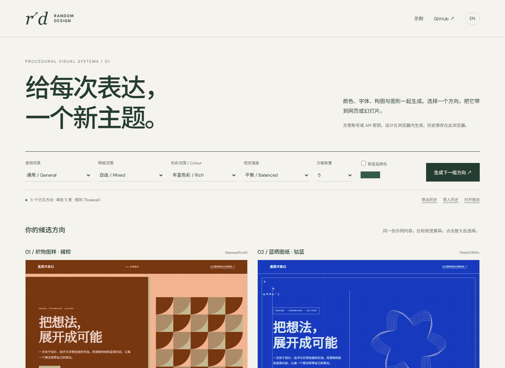
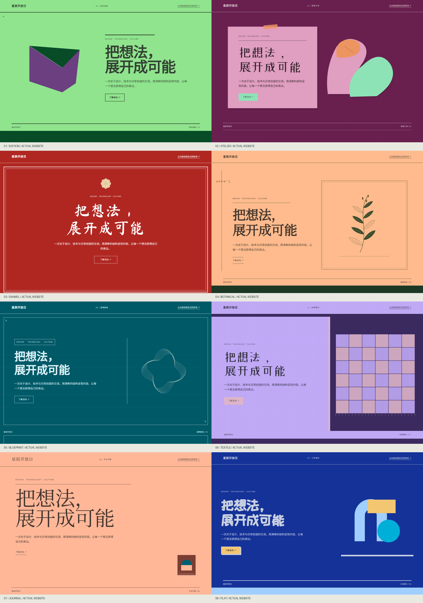
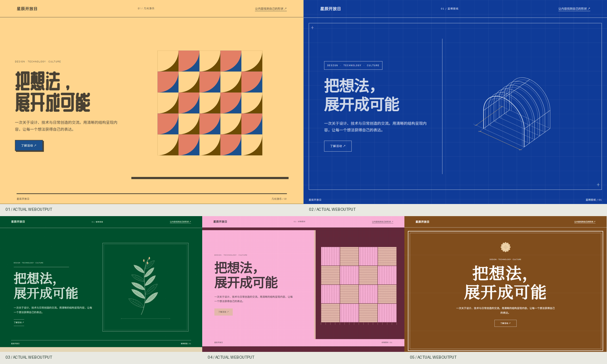
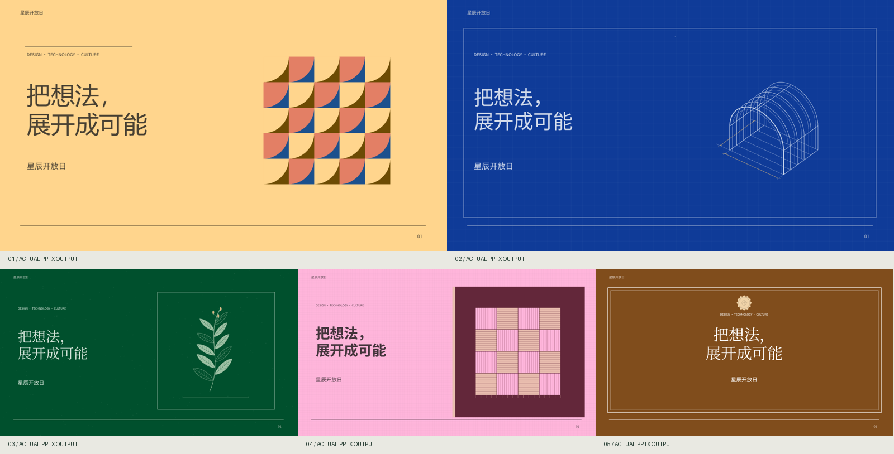

<div align="center">

[简体中文](README.md) · [**English**](README.en.md)

# random-design

### Generate visual directions for websites and presentations. Choose, then build.

Colour, type, composition and procedural graphics work together. Portable history reduces frequent recurrence of similar recent themes.

[**Open the studio →**](https://xingchenyd.github.io/random-design/) · [Compare five real examples](https://xingchenyd.github.io/random-design/examples/english/compare.html) · [Architecture](docs/architecture.md) · [Integrations](docs/integrations.md)



**Independent implementation · Browser / CLI / MCP / Skill · English + Chinese · MIT · No model API key**

</div>

## Visual direction in v0.2

The default uses **chromatic large canvases**, not almost-white/almost-black stock with different accent swatches. Twelve hue families supply continuous colours; neutral grounds are an explicit option.

A coherent visual grammar constrains type, composition, material and the purpose of the graphic. A plant shares one stem; projection lines describe one construction; a textile follows one repeat system; a sign gives priority to type and its border. Independent ornament sampling and automatic mirrored/rotated translucent copies have been removed.

Eight curated grammars currently cover print editions, cut paper, enamel signs, botanical folios, cyanotype studies, textiles, editorial design and constructed geometric play. These are finite foundations with procedural variants, not a claim of unlimited original art movements. [Design logic and visual acceptance criteria →](docs/visual-direction.md)

[Browse actual websites for all eight visual grammars →](https://xingchenyd.github.io/random-design/examples/catalogue/)



## What it does

random-design generates several concrete visual specifications, previews them with the same content and lets you choose a direction. Download the website, six editable PowerPoint sample slides, JSON, CSS tokens, SVG or a brief for another design agent. Supplied copy, facts, numbers and narrative voice are not randomized.

The engine combines inspectable visual operators and continuous parameters instead of storing thousands of completed themes. It does not invent new art movements or font files. Parameter uniqueness, perceived novelty and design quality are different claims: fingerprints address the first, attribute distances help with the second, and human visual review remains essential.

## Real examples





[Compare English websites](https://xingchenyd.github.io/random-design/examples/english/compare.html) · [Chinese examples](https://xingchenyd.github.io/random-design/examples/compare.html)

| Direction | Website | Six editable slides | Specification |
|---|---|---|---|
| 01 | [Open](examples/english/01/page.html) | [PPTX](examples/english/01/theme.pptx) | [JSON](examples/english/01/design.json) |
| 02 | [Open](examples/english/02/page.html) | [PPTX](examples/english/02/theme.pptx) | [JSON](examples/english/02/design.json) |
| 03 | [Open](examples/english/03/page.html) | [PPTX](examples/english/03/theme.pptx) | [JSON](examples/english/03/design.json) |
| 04 | [Open](examples/english/04/page.html) | [PPTX](examples/english/04/theme.pptx) | [JSON](examples/english/04/design.json) |
| 05 | [Open](examples/english/05/page.html) | [PPTX](examples/english/05/theme.pptx) | [JSON](examples/english/05/design.json) |

The examples use a fictional event and explicitly illustrative chart data. The web and PPTX versions share the same specification and adapt it to their medium.

## Browser: no installation

Open [the public studio](https://xingchenyd.github.io/random-design/). Select a scenario, light/dark range, intensity and optional brand colour. Generate directions, enlarge a preview, select it and download the outputs. Lock palette, typography, graphic family or composition while exploring the remaining dimensions. The EN / 中文 control switches interface and sample-content language.

Generation and history storage run in the browser. No account or model API is needed. Optional Google Fonts stylesheets are external requests; local fallbacks apply offline. Export/import history across devices; there is no automatic cloud synchronization.

## Run from source

Requires **Node.js ≥22**. This package is not published to npm.

```sh
git clone https://github.com/xingchenyd/random-design.git
cd random-design
npm ci
npm run build
npm run studio
```

Open the printed local URL (default `http://127.0.0.1:4173`). To generate files directly:

```sh
node src/cli.js generate --scenario academic --language en --out output/academic-01
node src/cli.js generate --scenario product --mode light --brand '#336699' --out output/product-01
```

Each new output directory contains `roll.json`, `history.json`, `compare.html` and numbered directories with `design.json`, `brief.md`, `tokens.css`, `graphic.svg`, `page.html` and `theme.pptx`. Existing output directories are never overwritten.

## How it works

The pipeline is **constraints → procedural candidates → readability and recent-distance checks → diverse previews → selection → frozen specification → web / PPT / agent**.

- Colours are generated in OKLCH with gamut handling, semantic roles and selected text contrast checks.
- Sixteen real font-role profiles include CJK title options. Type scale, tracking, leading and weight are part of the system.
- Each grammar permits compatible spatial relationships, balance, density and rhythm.
- Eleven structured graphic operators draw one subject or one disciplined repeat system. No automatic mirrored ghosts or arbitrary rotations.
- Surface, layout and typography rules are constrained by academic, business, product, culture, creative or general use, plus calm/balanced/bold intensity.

SHA-256 supports deterministic sampling and visual fingerprints; hashes do not create aesthetics. Read the [full architecture and limitations](docs/architecture.md).

## Reduced recurrence

All retained history is checked for exact visual fingerprints. Recent similarity is checked against the last **40 shown directions** by default, plus directions already chosen within the current set. A weighted attribute distance compares art direction, actual canvas colour, typography, composition, graphics and density. Best-candidate sampling favours greater separation. Infeasible requests fail explicitly without silently lowering the threshold.

Related visual languages may return outside the recent window. This is reduced frequent recurrence, not infinite global perceptual uniqueness. Intentional reuse of a selected theme is allowed.

Node history defaults to `~/.random-design/history-v2.json`, configurable with `RANDOM_DESIGN_HISTORY` or `--history`. Browser history is separate; export/import merges it. Remote HTTP uses client-supplied history.

```sh
node src/cli.js history-export --out history-backup.json
node src/cli.js history-import --file history-from-browser.json
node src/cli.js select --id FULL_DESIGN_ID
```

`--no-history` explicitly disables both history reads and writes for isolated examples or tests.

v0.2 uses `random-design/2` and separate history storage, preserving v0.1 data. Use the matching [v0.1.0 release](https://github.com/xingchenyd/random-design/releases/tag/v0.1.0) to reproduce old specifications.

## Lock and reproduce

```sh
node src/cli.js generate --lock examples/01/design.json --lock-fields palette,font --out output/locked-01
node src/cli.js reproduce --file examples/roll.json --out output/reproduced-01
node src/cli.js brief --file examples/01/design.json --language en
node src/cli.js validate --file examples/01/design.json
```

Keep the JSON and matching release. Repeating a seed requires the same request, history and code version to repeat candidate selection. Saved JSON reproduces visual rules, not pixel-identical LLM output. Use `--content content.json` to replace sample copy; see [content example](docs/content.example.json). The PPTX exporter is a six-slide theme specimen, not an arbitrary content-to-deck layout optimizer.

## Agent integration

| Environment | Route |
|---|---|
| Codex | Portable skill + stdio MCP, or Node in a cloud workspace |
| WorkBuddy | Configure stdio MCP in its plugin UI; import the skill archive |
| Claude Code / Cursor | Standard MCP configuration + skill folder |
| Ordinary ChatGPT web | Use studio, download specification and assets, upload to the conversation |
| Custom-MCP web clients | Deploy the Streamable HTTP service and register it using supported authentication |
| Your app | Import the Node or browser ESM engine |

Tools: `generate_directions`, `render_design`, `validate_design`, `compare_designs`, `get_capabilities`.

**[Configuration examples and account-specific limits →](docs/integrations.md)**

[Download portable skill](releases/random-design-skill.zip) · [Skill entrypoint](skills/random-design/SKILL.md)

The static studio is publicly usable. A hosted remote MCP endpoint, OAuth gateway and account setup are not included.

## Validation and limits

```sh
npm run check
npm run benchmark
npm run test:mcp
npx playwright install chromium
npm run test:browser
```

Actual results live in [docs/validation](docs/validation). Technical benchmarks check fingerprints, constraints and recent attribute distance. They are not evidence of aesthetic quality. Visual acceptance prioritizes actual website captures, imported-PPTX renders and coherent graphic structure. Regression checks include actual canvas chroma/lightness and grammar compatibility. Browser checks cover desktop, 390px width, imports, downloads and languages; they are not real-device tests.

PPTX text, basic shapes, tables and charts remain editable. Complex procedural artwork is an SVG image. Fonts are referenced, not embedded; install them or agree on substitutions. Font and SVG behaviour varies across PowerPoint, WPS and Google Slides. Render inspection and native application testing are reported separately.

## Authorship

Created by **xingchenyd**. Independent code, visual rules, tests and interfaces; no core code or style data copied from hash-design. The compare–select–freeze workflow was inspired by [qybaihe/hash-design](https://github.com/qybaihe/hash-design).

[MIT License](LICENSE) · [Dependencies and fonts](THIRD_PARTY_NOTICES.md) · [Contributing](CONTRIBUTING.md)
