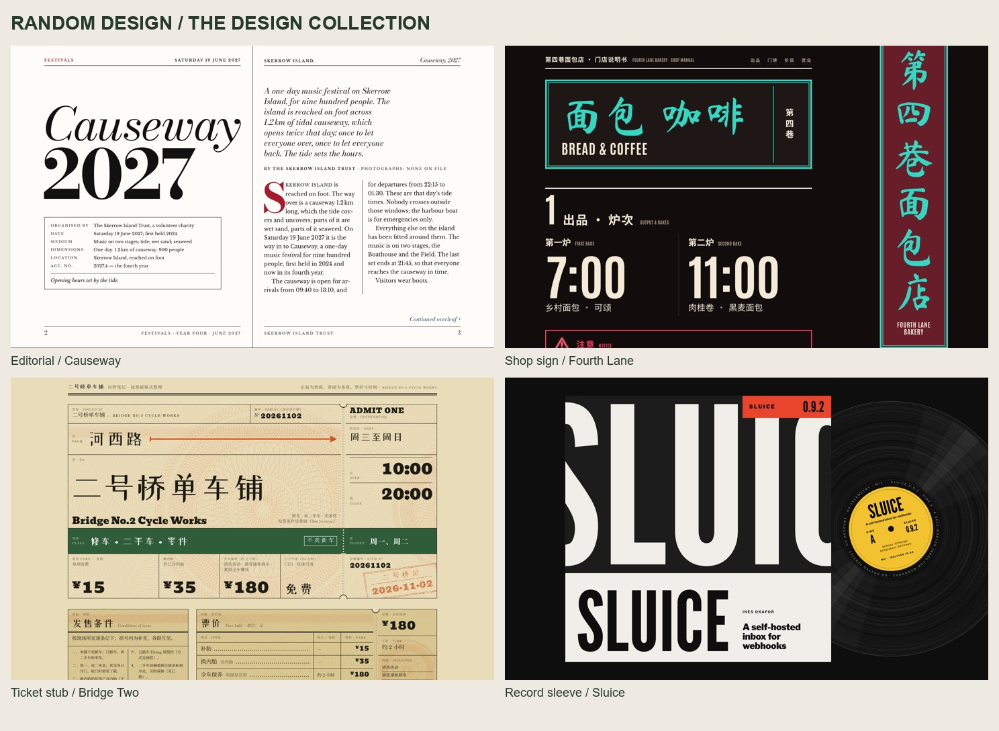
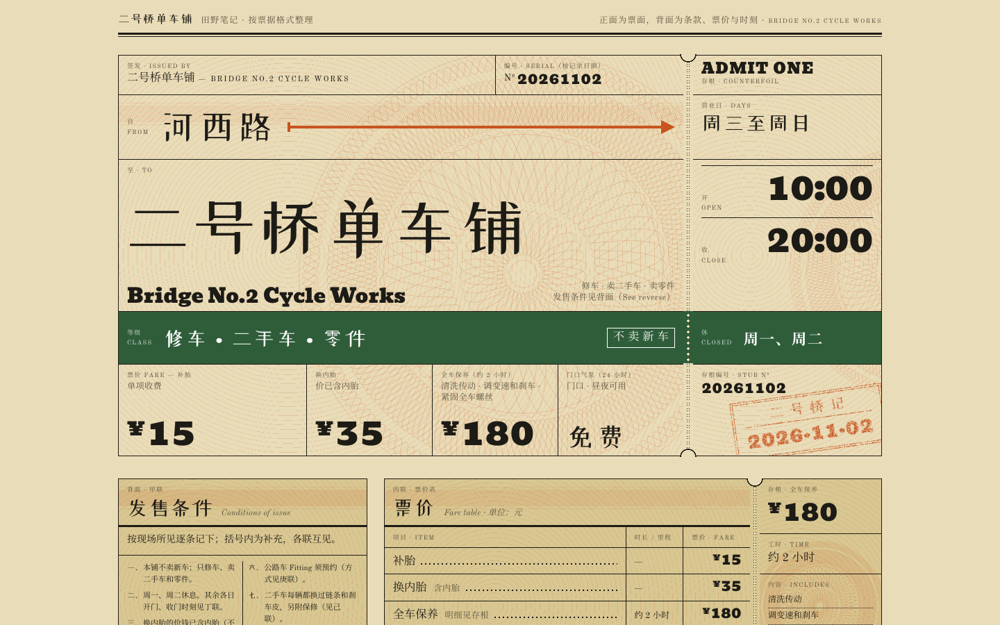
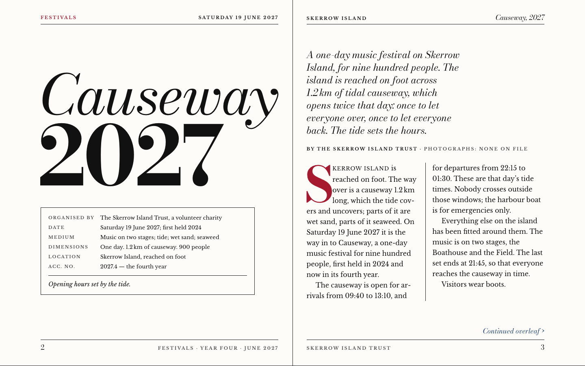
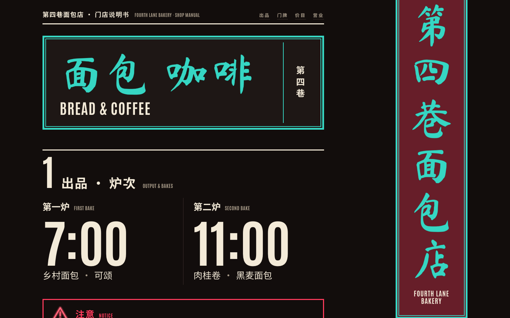
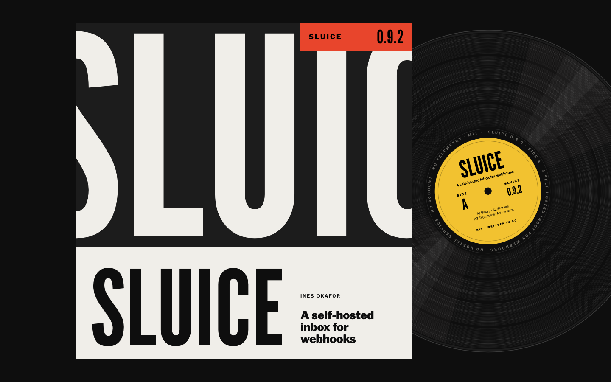
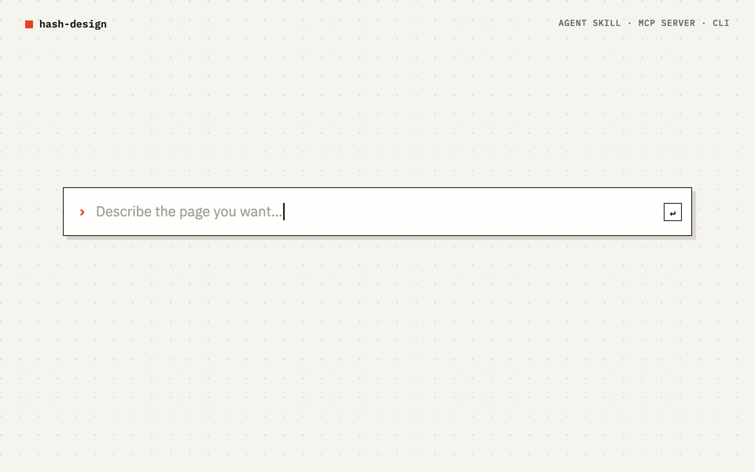
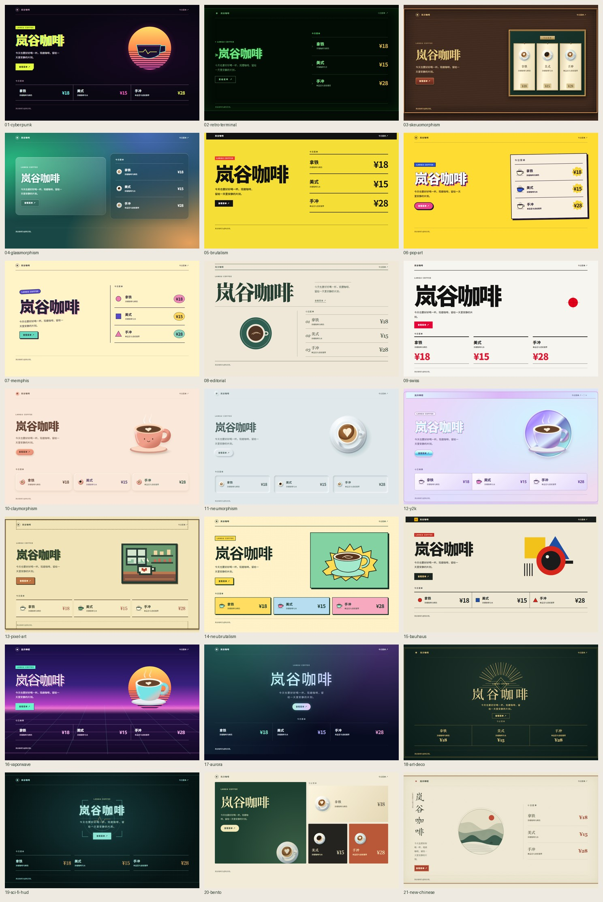

[**简体中文**](README.md) · [**English**](README.en.md)

# random-design

### 先看见好的设计，再把它用于你的内容。

为网页与 PPT 选主题、比较方案、保留可复用的设计规范。

[**打开工作台 ↗**](https://xingchenyd.github.io/random-design/) · [20 个完整案例](https://xingchenyd.github.io/random-design/showcase/) · [40 套风格规则](https://xingchenyd.github.io/random-design/reference/?lang=zh) · [21 种固定风格](https://xingchenyd.github.io/random-design/presets/)

**Browser · CLI · MCP · Skill · 中文 / English · MIT**

上图是迁入的真实网页截图：杂志排版、港式招牌、票券、唱片封套。原始案例来自 **qybaihe/hash-design（MIT）**。

**这是 xingchenyd 独立创建并维护的仓库，不是 GitHub fork。** 原 fork 中的设计规则、完整案例、截图、brief 与源码已迁入这里。[上游作者和 MIT 许可](THIRD_PARTY_NOTICES.md)完整保留；独立仓库身份不意味着把复用的作品署名为自己原创。

## 三种入口，一起使用

| 入口 | 作用 | 实际输出 |
|---|---|---|
| **40 套参考规则** | 选设计语言，按内容做完整作品 | 排印、网格、配色、构图与自检 brief；由 Agent 继续执行 |
| **21 种固定风格** | 按名字直接选用和比较 | 网页、JSON、SVG、六页可编辑 PPTX 样张 |
| **随机哈希变化** | 在约束内探索，降低近期重复 | 候选主题、预览、历史和可复用规范 |

40 套规则与 21 种固定风格存在重合，**不能相加宣称为 61 种独立风格**。参考模式保留上游的离散组合映射；原引擎保留连续配色与近期历史筛选。不承诺无限不重复。

## 完整设计作品集 · 20 个网页

同一份事实，五种完整实现。以下页面保留原排版、插图和细节，已在本项目站点托管。点击大图或风格名称打开完整网页。

### 二号桥单车铺

[瑞士网格](https://xingchenyd.github.io/random-design/showcase/bridge-two-bikes/previews/01-swiss-grid.html) · [时装画册](https://xingchenyd.github.io/random-design/showcase/bridge-two-bikes/previews/02-couture-lookbook.html) · [票根](https://xingchenyd.github.io/random-design/showcase/bridge-two-bikes/previews/03-ticket-stub.html) · [游戏说明书](https://xingchenyd.github.io/random-design/showcase/bridge-two-bikes/previews/04-game-manual.html) · [老黄历](https://xingchenyd.github.io/random-design/showcase/bridge-two-bikes/previews/05-chinese-almanac.html)

### Causeway — a music festival on Skerrow Island

[工程图版](https://xingchenyd.github.io/random-design/showcase/causeway-festival/previews/01-engineering-plate.html) · [地形图](https://xingchenyd.github.io/random-design/showcase/causeway-festival/previews/02-topographic-map.html) · [手作温度](https://xingchenyd.github.io/random-design/showcase/causeway-festival/previews/03-warm-handmade.html) · [杂志编辑](https://xingchenyd.github.io/random-design/showcase/causeway-festival/previews/04-editorial-magazine.html) · [孟菲斯](https://xingchenyd.github.io/random-design/showcase/causeway-festival/previews/05-memphis-pop.html)

### 第四巷面包店

[公文表格](https://xingchenyd.github.io/random-design/showcase/fourth-lane-bakery/previews/01-bureaucratic-form.html) · [包豪斯](https://xingchenyd.github.io/random-design/showcase/fourth-lane-bakery/previews/02-bauhaus-primary.html) · [水墨印章](https://xingchenyd.github.io/random-design/showcase/fourth-lane-bakery/previews/03-ink-and-seal.html) · [Riso 双色套印](https://xingchenyd.github.io/random-design/showcase/fourth-lane-bakery/previews/04-risograph-duotone.html) · [港式招牌](https://xingchenyd.github.io/random-design/showcase/fourth-lane-bakery/previews/05-hk-shop-sign.html)

### Sluice — self-hosted webhook inbox

[唱片封套](https://xingchenyd.github.io/random-design/showcase/sluice/previews/01-record-sleeve.html) · [美术馆图录](https://xingchenyd.github.io/random-design/showcase/sluice/previews/02-gallery-catalogue.html) · [终端荧光](https://xingchenyd.github.io/random-design/showcase/sluice/previews/03-terminal-phosphor.html) · [学术论文](https://xingchenyd.github.io/random-design/showcase/sluice/previews/04-academic-paper.html) · [方格实验本](https://xingchenyd.github.io/random-design/showcase/sluice/previews/05-lab-notebook.html)

原 hash-design 演示动画（保留作者署名）

## 21 种固定风格 · 全部保留

以下是 v0.5 的实际浏览器截图。新版重排字号、留白、菜单分隔和价格层级：杂志用跨栏标题，瑞士用价格索引，波普与孟菲斯减少漂浮装饰，新中式增加细线山水。材质遵循各自的风格。

| 风格 | 风格 | 风格 |
|---|---|---|
| [01 · 赛博朋克](https://xingchenyd.github.io/random-design/?preset=cyberpunk&lang=zh) | [02 · 复古终端](https://xingchenyd.github.io/random-design/?preset=retro-terminal&lang=zh) | [03 · 拟物](https://xingchenyd.github.io/random-design/?preset=skeuomorphism&lang=zh) |
| [04 · 玻璃拟态](https://xingchenyd.github.io/random-design/?preset=glassmorphism&lang=zh) | [05 · 粗野主义](https://xingchenyd.github.io/random-design/?preset=brutalism&lang=zh) | [06 · 波普艺术](https://xingchenyd.github.io/random-design/?preset=pop-art&lang=zh) |
| [07 · 孟菲斯](https://xingchenyd.github.io/random-design/?preset=memphis&lang=zh) | [08 · 杂志排版](https://xingchenyd.github.io/random-design/?preset=editorial&lang=zh) | [09 · 瑞士风格](https://xingchenyd.github.io/random-design/?preset=swiss&lang=zh) |
| [10 · 黏土拟态](https://xingchenyd.github.io/random-design/?preset=claymorphism&lang=zh) | [11 · 新拟态](https://xingchenyd.github.io/random-design/?preset=neumorphism&lang=zh) | [12 · 千禧 Y2K](https://xingchenyd.github.io/random-design/?preset=y2k&lang=zh) |
| [13 · 像素风](https://xingchenyd.github.io/random-design/?preset=pixel-art&lang=zh) | [14 · 新粗野主义](https://xingchenyd.github.io/random-design/?preset=neubrutalism&lang=zh) | [15 · 包豪斯](https://xingchenyd.github.io/random-design/?preset=bauhaus&lang=zh) |
| [16 · 蒸汽波](https://xingchenyd.github.io/random-design/?preset=vaporwave&lang=zh) | [17 · 极光渐变](https://xingchenyd.github.io/random-design/?preset=aurora&lang=zh) | [18 · 装饰艺术](https://xingchenyd.github.io/random-design/?preset=art-deco&lang=zh) |
| [19 · 科幻 HUD 界面](https://xingchenyd.github.io/random-design/?preset=sci-fi-hud&lang=zh) | [20 · 便当盒布局](https://xingchenyd.github.io/random-design/?preset=bento&lang=zh) | [21 · 新中式](https://xingchenyd.github.io/random-design/?preset=new-chinese&lang=zh) |

这是同一家虚构咖啡店的主题样张，用于比较。实际项目需要按内容重排，不能把咖啡插图套到所有题材。v0.5 版式改进主要作用于网页；PPTX 保留独立的六页可编辑排版，并非网页截图或逐像素复制。

## 40 套规则怎么用

打开[规则选择器](https://xingchenyd.github.io/random-design/reference/)，输入项目名和每行一条的事实。指定风格或随机生成多套 brief。浏览器探索避开最近 15 个方向；指定风格允许重复。下载 brief + JSON，交给 Agent 制作网页或 PPT。

~~~text
按附带的 random-design brief 制作网页 / PPT。
保留原文、事实和数据，不要随机改写语气。
先提供 3 套内容一致的方案，选定后制作完整作品。
插图必须服务于内容，交付前检查实际渲染。
~~~

展开全部 40 套规则

| 方向 | 方向 |
|---|---|
| [超市促销单](https://xingchenyd.github.io/random-design/reference/?branch=supermarket-circular&lang=zh) | [工程图版](https://xingchenyd.github.io/random-design/reference/?branch=engineering-plate&lang=zh) |
| [交通导视](https://xingchenyd.github.io/random-design/reference/?branch=transit-wayfinding&lang=zh) | [终端荧光](https://xingchenyd.github.io/random-design/reference/?branch=terminal-phosphor&lang=zh) |
| [菜谱卡](https://xingchenyd.github.io/random-design/reference/?branch=recipe-card&lang=zh) | [凸版木活字](https://xingchenyd.github.io/random-design/reference/?branch=letterpress-woodtype&lang=zh) |
| [账本](https://xingchenyd.github.io/random-design/reference/?branch=ledger-accounting&lang=zh) | [瑞士网格](https://xingchenyd.github.io/random-design/reference/?branch=swiss-grid&lang=zh) |
| [复印小志](https://xingchenyd.github.io/random-design/reference/?branch=photocopy-zine&lang=zh) | [票根](https://xingchenyd.github.io/random-design/reference/?branch=ticket-stub&lang=zh) |
| [港式招牌](https://xingchenyd.github.io/random-design/reference/?branch=hk-shop-sign&lang=zh) | [手作温度](https://xingchenyd.github.io/random-design/reference/?branch=warm-handmade&lang=zh) |
| [包豪斯](https://xingchenyd.github.io/random-design/reference/?branch=bauhaus-primary&lang=zh) | [早期个人主页](https://xingchenyd.github.io/random-design/reference/?branch=web1-homepage&lang=zh) |
| [Riso 双色套印](https://xingchenyd.github.io/random-design/reference/?branch=risograph-duotone&lang=zh) | [学术论文](https://xingchenyd.github.io/random-design/reference/?branch=academic-paper&lang=zh) |
| [水墨印章](https://xingchenyd.github.io/random-design/reference/?branch=ink-and-seal&lang=zh) | [唱片封套](https://xingchenyd.github.io/random-design/reference/?branch=record-sleeve&lang=zh) |
| [药房标签](https://xingchenyd.github.io/random-design/reference/?branch=apothecary-label&lang=zh) | [构成主义海报](https://xingchenyd.github.io/random-design/reference/?branch=constructivist-poster&lang=zh) |
| [餐馆菜单板](https://xingchenyd.github.io/random-design/reference/?branch=diner-menu-board&lang=zh) | [游戏说明书](https://xingchenyd.github.io/random-design/reference/?branch=game-manual&lang=zh) |
| [赛事秩序册](https://xingchenyd.github.io/random-design/reference/?branch=varsity-sports&lang=zh) | [公文表格](https://xingchenyd.github.io/random-design/reference/?branch=bureaucratic-form&lang=zh) |
| [老黄历](https://xingchenyd.github.io/random-design/reference/?branch=chinese-almanac&lang=zh) | [装饰艺术](https://xingchenyd.github.io/random-design/reference/?branch=art-deco&lang=zh) |
| [时装画册](https://xingchenyd.github.io/random-design/reference/?branch=couture-lookbook&lang=zh) | [美术馆图录](https://xingchenyd.github.io/random-design/reference/?branch=gallery-catalogue&lang=zh) |
| [热敏小票](https://xingchenyd.github.io/random-design/reference/?branch=thermal-receipt&lang=zh) | [工业仪表](https://xingchenyd.github.io/random-design/reference/?branch=instrument-panel&lang=zh) |
| [余白](https://xingchenyd.github.io/random-design/reference/?branch=ma-whitespace&lang=zh) | [大报版面](https://xingchenyd.github.io/random-design/reference/?branch=broadsheet-newspaper&lang=zh) |
| [七十年代超级图形](https://xingchenyd.github.io/random-design/reference/?branch=seventies-supergraphic&lang=zh) | [植物标本](https://xingchenyd.github.io/random-design/reference/?branch=herbarium-specimen&lang=zh) |
| [地形图](https://xingchenyd.github.io/random-design/reference/?branch=topographic-map&lang=zh) | [杂志编辑](https://xingchenyd.github.io/random-design/reference/?branch=editorial-magazine&lang=zh) |
| [粗野原生](https://xingchenyd.github.io/random-design/reference/?branch=raw-brutalist&lang=zh) | [野外图鉴](https://xingchenyd.github.io/random-design/reference/?branch=field-guide-plate&lang=zh) |
| [方格实验本](https://xingchenyd.github.io/random-design/reference/?branch=lab-notebook&lang=zh) | [孟菲斯](https://xingchenyd.github.io/random-design/reference/?branch=memphis-pop&lang=zh) |

## 本地调用与跨环境接入

~~~sh
git clone https://github.com/xingchenyd/random-design.git
cd random-design
npm ci
npm run build
npm run studio

# Fixed style: HTML + JSON + editable PPTX
node src/cli.js preset --style editorial --out output/editorial

# Procedural variations
node src/cli.js generate --count 5 --out output/explore

# Reference rules: briefs, not rendered pages
node src/cli.js reference-list
node src/cli.js reference-roll --style editorial-magazine --count 1 --content facts.json --out output/reference
node src/cli.js reference-reproduce --file output/reference/reference-roll.json
~~~

facts.json:

~~~json
{"subject":"岚谷咖啡","facts":["拿铁 ¥18，浓缩咖啡与鲜奶","美式 ¥15，浓缩咖啡与水"]}
~~~

Node.js 22+。输出目录必须是新的，避免覆盖。参考模式使用 --seed 固定映射；保存 ref、constraints 与原文以完整复现。参考 CLI 不自动记录跨次历史；MCP 可传 exclude，浏览器保留最近方向。

| 环境 | 使用方式 |
|---|---|
| 普通浏览器 / ChatGPT 网页版 | 在线比较并下载 brief + JSON，再附给对话；不需要本机 Node，不会因粘贴仓库链接自动安装工具 |
| WorkBuddy / Codex / Claude Code / Cursor | [Skill ZIP](releases/random-design-skill.zip) 或 Node MCP 服务；导入方式取决于客户端实际版本 |
| 云端编程环境 | 克隆后运行 CLI，保留输出和历史文件 |

[详细接入说明](docs/integrations.md) · [Skill 执行规则](skills/random-design/SKILL.md)

MCP 新增 list_reference_styles、generate_reference_briefs、reproduce_reference_brief、critique_reference_page，保留原 7 个工具，共 11 个。参考库检查只用于参考模式，不能拿它禁止玻璃拟态等固定风格；自动分数也不是审美分数。

## 来源、复现与验证

- [完整上游快照](vendor/hash-design)固定于 e40a942，保留 227 个文件、40 套规则、4 项目 / 20 页面、原始 README 与 MIT 许可。
- [SHA-256 清单](vendor/hash-design.provenance.json)验证迁移完整性；原 fork 完整 Git 历史另有离线备份。
- [浏览器检查](docs/validation/browser.json)、[迁移检查](docs/validation/migration.json)、[MCP 检查](docs/validation/mcp.json)记录具体范围。
- 字体在线按需加载，离线替代；PPTX 不嵌入字体。协议测试不等于特定 WorkBuddy / ChatGPT 账号连接测试。
- 生成器为 random-design/3；网页固定风格渲染器为 composition/2。需要旧版像素效果时使用对应 release。

[MIT](LICENSE) · [开源来源](THIRD_PARTY_NOTICES.md) · [v0.5 迁移说明](docs/merge-v05.md)
