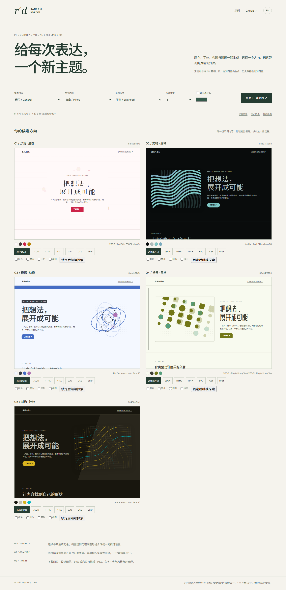
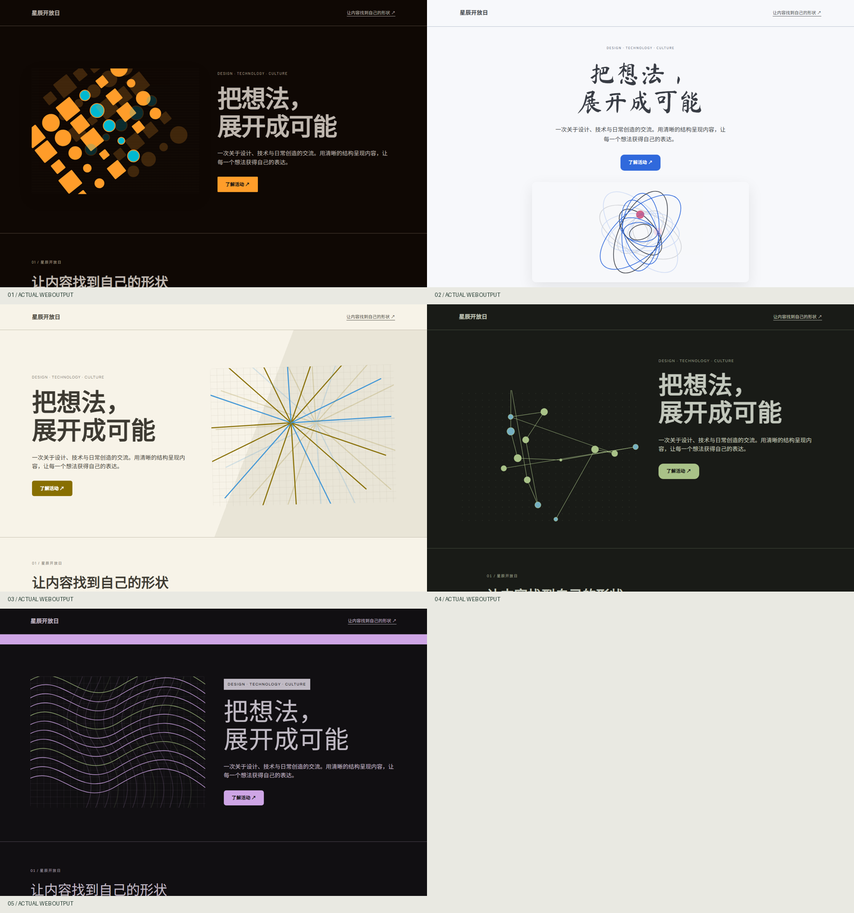
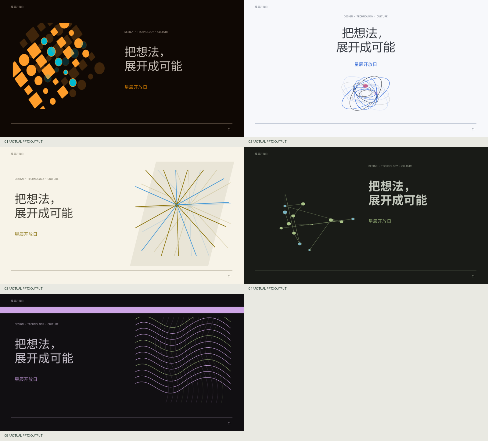
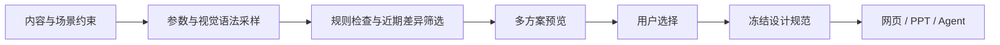

<div align="center">

[**简体中文**](README.md) · [English](README.en.md)

# random-design

### 为网页与 PPT 生成多套视觉方案，选择后再制作。

颜色、字体、构图、程序图形共同生成；记录历史，减少近期相近主题的反复出现。

[**打开在线工作台 →**](https://xingchenyd.github.io/random-design/) · [五方案实际对比](https://xingchenyd.github.io/random-design/examples/compare.html) · [设计机制](docs/architecture.md) · [跨环境接入](docs/integrations.md)



**独立实现 · 浏览器 / CLI / MCP / Skill · 中英文 · MIT · 无需模型 API 密钥**

</div>

## 它解决什么

做网页或幻灯片时，经常需要先看几种方向，再决定最终的视觉语言。random-design 把这一环节变成可以调用、保存和复现的工具。

它组合颜色、排印、空间关系和图形生成规则，输出一份具体的视觉规范，再提供相同内容的候选预览。你选择一个主题后，可以继续交给设计 Agent 制作真实项目，也可以直接下载网页与六页可编辑 PPTX 样张。**文案语气、事实和数据不参与随机改写。**

它使用有限、可检查的基础规则生成大量视觉组合。它不是预置几千套成品主题的列表，也不声称自动发明新的设计流派。**参数不同、看起来不同、设计得好，是三个不同的问题。** 本项目分别提供精确指纹、近期属性差异检查和实际预览；人的视觉判断仍然必要。

## 先看效果

[打开五种网页主题对比](https://xingchenyd.github.io/random-design/examples/compare.html) · [英文示例](https://xingchenyd.github.io/random-design/examples/english/compare.html)





以上图片由仓库实际产物截图或渲染而来。相同主题的网页和 PPTX 共用 `design.json`，针对媒介分别编排。演示内容为虚构活动，图表为明确标注的示例数据。

| 方案 | 网页 | 六页可编辑 PowerPoint | 设计规范 |
|---|---|---|---|
| 01 | [打开](examples/01/page.html) | [下载](examples/01/theme.pptx) | [JSON](examples/01/design.json) |
| 02 | [打开](examples/02/page.html) | [下载](examples/02/theme.pptx) | [JSON](examples/02/design.json) |
| 03 | [打开](examples/03/page.html) | [下载](examples/03/theme.pptx) | [JSON](examples/03/design.json) |
| 04 | [打开](examples/04/page.html) | [下载](examples/04/theme.pptx) | [JSON](examples/04/design.json) |
| 05 | [打开](examples/05/page.html) | [下载](examples/05/theme.pptx) | [JSON](examples/05/design.json) |

## 不安装，直接用

打开 **[在线工作台](https://xingchenyd.github.io/random-design/)**，设置场景、明暗范围、视觉强度和品牌色，生成一组候选。

每个候选都可以放大、选择，以及下载 JSON、HTML、PPTX、SVG、CSS 或设计说明。勾选颜色、字体、图形或构图，可以锁定它们继续探索。右上角 **EN / 中文** 切换界面与示例内容语言，不会自动翻译用户自带的内容。

计算和历史存储在浏览器内完成，无需登录。字体样式按需访问 Google Fonts；离线或字体服务不可用时会使用替代字体。导出/导入历史可连接多个设备或工作环境，但**没有自动云同步**。

## 源码运行

需要 **Node.js ≥22**。项目尚未发布到 npm；以下命令从源码运行。

```sh
git clone https://github.com/xingchenyd/random-design.git
cd random-design
npm ci
npm run build
npm run studio
```

浏览器打开终端显示的本地地址，默认 `http://127.0.0.1:4173`。

生成一组完整文件：

```sh
node src/cli.js generate --scenario academic --language zh --out output/academic-01
node src/cli.js generate --scenario product --mode light --brand '#336699' --out output/product-01
```

输出目录包括 `roll.json`、`history.json`、`compare.html`，以及每个方向的 `design.json`、`brief.md`、`tokens.css`、`graphic.svg`、`page.html`、`theme.pptx`。命令拒绝覆盖已有输出目录。

## 如何生成



| 层次 | 生成与约束 |
|---|---|
| 颜色 | OKLCH 中的色相、明度、彩度与色彩关系；生成语义色并检查指定文字对比度；品牌色可锁定 |
| 排印 | 16 组真实字体角色，包括中文标题字体；字号比例、字距、行距和字重参与生成 |
| 构图 | 9 个空间关系操作器，组合主次区域、比例、密度、留白、方向和节奏；不是 9 套完整主题 |
| 图形 | 10 类程序图形操作器，按数量、幅度、线宽、对称、旋转等参数生成 SVG |
| 表面 | 网格、细线、点阵、平面与层次策略，服从内容可读性 |
| 场景 | 学术、商务、产品、文化、创意、通用；场景约束和视觉强度共同限制候选范围 |

哈希用于确定性采样和视觉指纹。丰富程度来自规则表达能力，哈希本身不会创造美感。详见 [完整机制与限制](docs/architecture.md)。

## 减少重复，具体是什么意思

- 精确视觉指纹检查所有保留历史，避免相同规范再次自动出现。主题名称和随机种子不算新风格的依据。
- 默认与最近 **80 个已展示方向** 比较，按颜色、字体、构图、图形和密度等属性排除过近方案；同一轮候选也互相比较。
- 从一批候选中优先选择与已有方向差异更大的结果。达不到要求时明确失败，**不悄悄降低阈值**。
- 超出近期窗口后，相关视觉语言可能再次出现。这是减少频繁重复，不是“全球永不重复”的承诺。主动选择旧主题可以明确复用。

本机 CLI 历史默认存于 `~/.random-design/history.json`；可用环境变量 `RANDOM_DESIGN_HISTORY` 或 `--history` 指定。浏览器和 CLI 的历史相互独立，通过导出/导入合并。HTTP MCP 使用调用方携带的历史。

```sh
node src/cli.js history-export --out history-backup.json
node src/cli.js history-import --file history-from-browser.json
node src/cli.js select --id FULL_DESIGN_ID
```

`--no-history` 用于隔离演示或测试，会明确关闭历史读取和写入。

## 固定与复现

```sh
# 锁定已有规范中的颜色与字体，再生成其他维度
node src/cli.js generate --lock examples/01/design.json --lock-fields palette,font --out output/locked-01

# 根据保存的规范重建产物；不消耗新的历史
node src/cli.js reproduce --file examples/roll.json --out output/reproduced-01
node src/cli.js brief --file examples/01/design.json --language en
node src/cli.js validate --file examples/01/design.json
```

**保存 JSON 和对应发行版本。** 相同种子还需要相同请求、历史和代码版本，才能重现候选选择。视觉规范可复现，并不意味着任何模型生成的最终页面都像素相同。

`--content content.json` 可替换示例文字；内容字段见 [内容示例](docs/content.example.json)。PPTX 导出器是六页主题样张，长内容和复杂实际项目仍需要排版与渲染检查。

## 让 Agent 调用

| 环境 | 路线 |
|---|---|
| Codex | 仓库 Skill + 本机 stdio MCP，或云端 Node 源码调用 |
| WorkBuddy | 插件界面配置 stdio MCP；可导入 Skill 包 |
| Claude Code / Cursor | 通用 MCP 配置 + 对应目录的 Skill |
| ChatGPT 普通网页版 | 在线工作台生成，下载规范与素材后上传到对话 |
| 支持自定义 MCP 的网页客户端 | 部署本项目 Streamable HTTP 服务，按账号权限及认证方式注册 |
| 自己的应用 | JavaScript 核心库或浏览器 ESM，直接获得结构化规范 |

MCP 提供 `generate_directions`、`render_design`、`validate_design`、`compare_designs`、`get_capabilities` 五个工具。

**[完整配置、WorkBuddy 路径、ChatGPT 接入边界 →](docs/integrations.md)**

[下载便携 Skill 包](releases/random-design-skill.zip) · [Skill 入口](skills/random-design/SKILL.md)

公开工作台可以直接使用；本仓库不附带已部署的远程 MCP 服务、OAuth 网关或用户账号配置。

## 验证与已知边界

```sh
npm run check
npm run benchmark
npm run test:mcp
npx playwright install chromium
npm run test:browser
```

实际验证结果存于 [docs/validation](docs/validation)。基准会生成 10,000 套规范，检查视觉指纹、规则和近期属性差异。它不证明 10,000 套都具有人类感知上的独特风格。浏览器检查覆盖桌面、390px 宽度、下载、导入与中英文；它不等于真实手机测试。

PPTX 的文字、基本形状、表格和图表可编辑，复杂图形为 SVG 图片。字体不嵌入，请安装所选字体或接受替换。PowerPoint / WPS / Google Slides 的字体和 SVG 支持可能不同。实际渲染检查与原生编辑器测试在验证记录中分别标明。

## 项目与来源

作者：**xingchenyd**。本项目独立实现，核心代码和风格数据未复制自 hash-design。多方案比较、选择和保存设计规范的工作流受到 [qybaihe/hash-design](https://github.com/qybaihe/hash-design) 启发。

[MIT License](LICENSE) · [依赖与字体说明](THIRD_PARTY_NOTICES.md) · [贡献指南](CONTRIBUTING.md)
