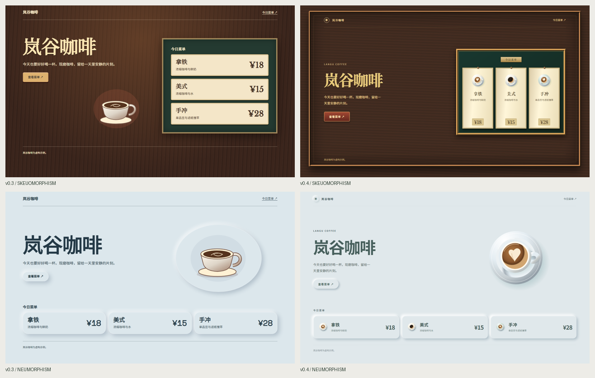

# v0.4 material revision / 材质重做

## Review basis

The supplied 21-style comparison video was reviewed again, including the close-up contact sheets. The earlier renderer identified the styles but often replaced surfaces with flat colour and reused one cup contour. v0.4 keeps the same names, content and selectable presets while revising type, surface, object lighting and composition. The source video remains private. These are independent adaptations, not pixel-identical replicas.

- Web: new material layer in `src/material-css.js`, subject and menu illustrations in `src/core/material-art.js`, composition adjustments in `src/preset-website.js`.
- PPTX: shared original SVG illustrations, material substrates and hanging-tag cover arrangement. Text, table and chart stay native and editable. Browser blur and some CSS print effects are adapted rather than reproduced exactly in PowerPoint.
- Portability fix: transparent radial-gradient stops rendered as black disks in the slide renderer. Contact shadows now use layered low-opacity shapes; shallow elliptical coffee and saucer surfaces avoid that renderer's radial-gradient limitation.
- Content: original user text, names, descriptions and prices remain separate from styling. Sample cafe drawings should be replaced when irrelevant to a user's subject.

## GitHub failure diagnosis

Check #7 on main and Check #8 on v0.3.0 both passed core tests and the build. Their browser jobs failed in `npx playwright install --with-deps chromium` because `azure.archive.ubuntu.com` could not be resolved while apt downloaded optional fonts. Browser tests were skipped as a consequence. This was an installation failure, not a reported application assertion failure.

The workflow now pins the hosted Ubuntu 24.04 runner and installs Playwright Chromium without rerunning apt dependency installation. Actual browser tests still run and can fail. A 15-minute job timeout bounds stalled installations. The first repaired remote Check and Pages deployment both succeeded at commit `c0b7cdc9a0a6cdb6579a2b87fedfec608f5777aa`. Historical failed notifications remain in GitHub; no notifications were marked read or deleted.

[Failed main run](https://github.com/xingchenyd/random-design/actions/runs/43041670645) · [Failed tag run](https://github.com/xingchenyd/random-design/actions/runs/43042099747) · [First successful repaired Check](https://github.com/xingchenyd/random-design/actions/runs/43576946781)

## Validation and limits

- 16 Node tests: fixed selection, reproducibility, history, palette locks, JSON validation, exports and content preservation.
- 84 fixed-style browser combinations: 21 styles × Chinese/English × 1280/390 px. Checks include title containment and menu heading/body/price containment, not only document overflow.
- 64 existing procedural direction/layout/language/viewport combinations; real studio mode selection, import and native PPTX download.
- Seven MCP tools tested over local stdio and Streamable HTTP. This is not an account-level WorkBuddy or ChatGPT integration test.
- 42 PPTX files exported; 62 slides rendered by Artifact Tool: Chinese and English covers for every style, plus all remaining Chinese pages for Skeuomorphism, Glassmorphism, Neumorphism and New Chinese Style. The rendered covers and representative content pages were visually reviewed. PowerPoint/WPS desktop was not tested.
- All 21 Chinese website views captured with local font fallbacks at 1280 × 760. External font availability changes appearance. Font stylesheets remain optional; fonts are not embedded in PPTX.
- Local sampling/history rules remain `random-design/3` with library `3dab00d49b610d74`. The visual renderer is now `material/1`. Old JSON is accepted and rendered by the new renderer; use the old release for the exact old image. Random history remains separate from fixed selection.
- Automated geometry checks do not prove aesthetic equivalence to the video, nor full contrast conformance on gradient or translucent backgrounds. Inspect real output for the user's content.

Run `npm run check`, `npm run test:browser`, `npm run test:mcp`. Run `node scripts/material-review.js` to capture the 21 local web previews after installing Playwright Chromium. The source video is not required to run the project.
